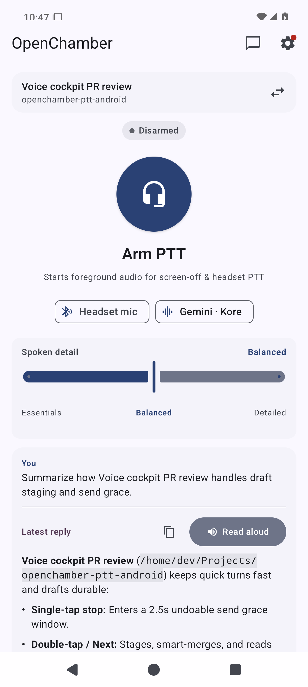

# OpenChamber PTT (Android)

An Android push-to-talk voice companion for [OpenChamber](https://github.com/openchamber/openchamber) and OpenCode. Talk to coding sessions from a Bluetooth headset, lock screen, or floating Android Bubble—without always-on hotword listening.

<p align="center">
  
</p>

## Install

### Download a signed APK (recommended)

Grab the latest APK directly from [GitHub Releases](https://github.com/chen-ye/openchamber-ptt-android/releases) on your Android device (Android 10+ / API 29+):

- **Tagged releases (`v*`):** Tested milestone builds (`openchamber-ptt-<version>.apk`).
- **Rolling prerelease (`prerelease`):** Latest signed build from `main` (`openchamber-ptt-prerelease.apk`).

Both release channels use the same signing key, so you can update directly in place without uninstalling.

### Or install over ADB

If you already have an APK locally and ADB connected over USB or wireless debugging:

```bash
adb connect <device-ip>:<port>
adb install -r path/to/openchamber-ptt.apk
```

*(CI debug artifacts use an ephemeral runner keystore, so switching between a local debug build, a CI debug artifact, and a signed release APK requires uninstalling the earlier package first.)*

---

## Quick start

1. **Grant permissions:** Open **OpenChamber PTT** and tap **Grant Permissions** (`Microphone`, `Nearby devices` on Android 12+, and `Notifications` on Android 13+). Optionally tap **Battery Exempt** so Android does not suspend lock-screen headset audio.
2. **Connect a server:** Enter your OpenChamber **Server URL** (Tailscale `http://` or `https://` works) and password, then tap **Connect**. You can add more hosts later from **Settings** or **`+ Server`** in the session picker.
3. **Choose a session:** Tap the session bar at the top to open **Select Session**, search by session name or project path, or filter to **Unread** sessions.
4. **Arm and talk:** Tap **Arm PTT**, then tap the central mic orb—or your Bluetooth headset play/pause button—to start and stop speaking.
5. **Listen or open on screen:** Replies read aloud automatically while armed. Use **Read aloud** / **Stop** on **Latest reply** anytime, or tap **Open in OpenChamber** to jump straight into the session in the OpenChamber app.

---

## Everyday workflows

### Bluetooth headset & lock-screen controls

Once armed, the service keeps media-button focus active so you can run turns with the screen off:

| Current state | `1x` tap | `2x` tap or `Next` | `3x` tap or `Previous` |
|---|---|---|---|
| **Armed & idle** | Start recording | Replay latest reply | — |
| **Recording** | Stop into 2.5s send grace | Stage, organize & read back draft | Discard recording |
| **Send grace (2.5s)** | Undo send into staged draft | — | — |
| **Staged draft / preview** | Interrupt preview or append voice | Send draft to agent | Discard draft |
| **Speaking reply** | Stop speech immediately | — | — |

Distinct sound cues (`studio` earcons, `CC0-1.0`) let you tell apart arming, recording start, staged pause, send grace, sent, turn complete, barge-in, discard, permission needed, and expired login without looking at your phone.

### Quick turns vs. staged drafts

- **Quick turns (`1x` tap):** Stopping enters a 2.5-second **Tap to Undo** grace window before sending. Tap the orb or headset button again during that window to pull the transcript into an editable draft instead of sending.
- **Staged drafts (`2x` tap / `Next`):** Useful for longer, multi-part thoughts. Your recording is cleaned up, smart-merged into any existing draft, and read back aloud. You can append more voice bursts, tweak the text in **Prompt draft**, tap **Re-organize**, or discard.
- **Safety cap:** Recordings longer than 5 minutes play a warning cue at 4:45 and automatically stage as a draft at 5:00 rather than sending unreviewed text.
- **Per-session persistence:** Drafts stay saved per server and session across app restarts, **Disarm**, and session switches until sent or discarded.

### Sessions, unread indicators & multi-server

- **Cross-host switcher:** View sessions across every signed-in OpenChamber server in one sheet, narrow with server filter chips, and re-authenticate expired hosts individually without losing other connections.
- **Hierarchical subagents:** Subagent sessions appear nested and collapsed under their parent session by default; tap a parent row's right-side counter to expand or collapse its subagents.
- **Search by name or path:** Filter across session titles, IDs, and project directories—parents automatically expand when a nested subagent matches your query.
- **Read-state preservation:** Top-level sessions with unseen replies (including failed unseen turns) display an unread dot and work with the **Unread** filter. Selecting or listening to a session here **does not** mark it read in OpenChamber desktop or web.

### Floating Bubble, headset mic & hands-free stop controls

- **Floating Bubble:** Enable Bubbles via **Settings** → **System** → **Bubble Settings** to keep a compact PTT overlay floating over other apps.
- **`Headset mic` toggle:** Leaves spoken replies on stereo A2DP media audio at all times. Toggle **Headset mic** on (persisted across restarts) when you want Bluetooth HFP/SCO or Call mode to open your headset microphone strictly while recording.
- **Smartwatch recording control:** While recording, a silent companion notification with a **Stop recording** action mirrors to Garmin and Wear OS watches (enabled by default under **Settings** → **Controls** → **Smartwatch**; enable OpenChamber PTT in Garmin Connect notifications and grant Android 13+ Notifications permission).
- **Presets, screen-off Volume-key controls & Shokz / Call mode (`Settings` → `Controls`):** Pick **Standard** or **Shokz / Single-Tap** (or tune individual options while previewing the live **Active Gesture Map**):
  - **Call mode (HFP):** Opens a transient Telecom call during recording so headset call-hangup ends capture into **Quick send** (2.5s undo), **Send now** (immediate send), or **Stage draft**.
  - **Single-tap only & AVRCP toggle:** Remove the 350ms double-tap delay and disable `Next`/`Previous` shortcuts on headsets that swallow multi-taps or emit spurious track skips.
  - **Screen-off phone Volume keys:** Active strictly when the screen is off (screen-on presses keep normal volume). Supports stopping recording (`Any → Quick send`, `Any → Stage draft`, or `Up Send · Down Stage`) and controlling staged drafts (`Up Send · Down Discard` or `Up Send only`).

---

## Voice, speech & server extensions

Tap the voice chip (for example `Gemini · Kore`) for quick voice selection, or open **Settings** to customize the full pipeline globally or per server:

- **Reply Readback & Routing (`Settings` → `Voice`):**
  - **Spoken:** Rewrites technical markdown, code, and file paths into natural spoken prose at **Essentials**, **Balanced**, or **Detailed** depth, with a collapsible **Spoken summary** readout under the reply.
  - **Sanitized:** Strips markdown, code blocks, and URLs.
  - **Raw:** Speaks the exact reply text (also used automatically for staged draft readback).
- **Audio Cues (`Hybrid` / `Vocal cues` / `Studio tones`):** Default **Hybrid** pairs crisp studio earcons for button taps and live-mic boundaries with short pre-cached spoken cues for latency bridges, blind spots, and errors—or switch to full **Vocal cues** or **Studio tones** in **Settings** → **Voice**.
- **Voice Roles (`Main Agent`, `Operator`, `Vocal Cues`):** Select any provider (`TTS Order`, **Gemini**, **Kokoro**, **ML Kit**, **System**, or **OpenAI**) and voice directly per role in **Voices** or **Settings** → **Voice** → **Voice Roles** with one-tap audio preview—without needing to change the global fallback provider first—or leave **Operator** and **Vocal Cues** on **Auto** for collision-free distinct defaults.
- **Text-to-Speech Fallback Order:** Toggle and reorder **Gemini Bridge**, **Local Kokoro**, **ML Kit GenAI TTS**, **Android System TTS**, and **OpenAI Cloud**—tried top-to-bottom when a role follows TTS Order or its chosen provider fails.
- **Client-side TTS & summary caching:** Spoken translations and synthesized audio clips (including warmed vocal cues and previews) are cached locally on device for instant offline re-reads and can be inspected or cleared under **Settings** → **Voice** → **TTS Cache**.
- **Dictation & Input:** Choose **OpenChamber Parakeet** (host transcription + cleanup) or on-device **ML Kit GenAI** (Advanced or Basic) with optional automatic fallback to Parakeet and **Quick-mode transcript cleanup**.
- **Tool permission alerts:** When an agent waits on a tool approval, alerts hold for 4 seconds before announcing so server-side auto-approvers can handle routine approvals silently.

### Optional server extensions & device requirements

- **Core OpenChamber server:** Session switching, Parakeet STT, Kokoro/OpenAI TTS, `/api/small-model/generate` spoken rewriting/draft cleanup, and turn events work against a standard OpenChamber server.
- **`gemini-tts-bridge`:** Required only for the **Gemini Bridge** TTS voice catalog and synthesis.
- **`gemini-decisions-bridge`:** Optional quick-turn router (`gemini-decision-1`) that lets short voice commands adjust spoken detail/mode live or ask quick follow-ups about the latest reply without disturbing the main session (fails open to normal prompting when absent).
- **On-device ML Kit GenAI (STT/TTS):** Requires physical Android hardware with AICore and Google Speech Services support (such as Pixel 8+ or Galaxy S25+ with a locked bootloader); unsupported devices and emulators report `Unavailable` in Settings diagnostics.

---

## Troubleshooting

- **Headset button stops responding with screen off:** Open **Settings** → **System** → **Battery** (or tap **Battery Exempt** during initial setup) to exempt OpenChamber PTT from background battery restrictions, and make sure the app is **Armed** (not Disarmed).
- **Audio sounds muffled when armed:** Turn **Headset mic** off to return Bluetooth output to A2DP media audio and use the phone microphone.
- **ML Kit GenAI shows `Unavailable`:** Use **OpenChamber Parakeet** for STT and **Gemini Bridge**, **Local Kokoro**, **Android System TTS**, or **OpenAI Cloud** for TTS—or tap **Copy ML Kit diagnostics** in **Settings** → **Voice** to inspect device service availability.
- **Headset button cannot stop recording while `Headset mic` is on:** Many Bluetooth headsets switch their multifunction button out of AVRCP media mode during active HFP mic capture. Under **Settings** → **Controls**, pick **Shokz / Single-Tap** (or configure **Bluetooth capture mode** = **Call mode (HFP)**, **Single-tap only**, screen-off **Phone Volume Keys**, and **Mirror recording control to watch**), and use **Settings** → **System** → **Live Audio & BT Debug** to inspect live button, SCO, Telecom, and focus events on device.
- **Telemetry & live audio diagnostics:** Open **Settings** → **System** → **Live Audio & BT Debug** for a live ring buffer of accepted and ignored button, route, Bluetooth, Telecom, and focus events, or **Voice UX Telemetry Log** to copy local timing logs (`JSONL`).

---

## Building from source & CI

### Prerequisites

- JDK 21 (for example, `/home/linuxbrew/.linuxbrew/opt/openjdk@21`)
- Android SDK (`compileSdk = 35`, `minSdk = 29`) and `adb`

### Build and test

```bash
JAVA_HOME=/home/linuxbrew/.linuxbrew/opt/openjdk@21 \
ANDROID_HOME=$HOME/Android/Sdk \
./gradlew testDebugUnitTest --rerun-tasks assembleDebug --console=plain
```

Output APK: `app/build/outputs/apk/debug/app-debug.apk`.

For offline Android emulator UI QA (hierarchical sessions, unread/failed indicators, search, and multi-server chips), run the local mock OpenChamber server and connect the emulator to `http://10.0.2.2:18401` (and `http://10.0.2.2:18402`) with any non-empty password:

```bash
bun scripts/mock-openchamber-server.mjs --help
```

To regenerate the README screenshot on a temporary Pixel 10 Pro resolution emulator (`1280x2856 @ 480 dpi`):

```bash
bun scripts/capture-pixel10-pro-screenshot.mjs
```

### CI and releases

- [CI workflow](.github/workflows/ci.yml) runs unit tests, `lintDebug`, and `assembleDebug` on every pull request and push to `main`.
- [Release workflow](.github/workflows/release.yml) builds and verifies a signed release APK on every `push` to `main` (updating the rolling `prerelease` tag and `openchamber-ptt-prerelease.apk`) and on `v*` tag pushes or manual `workflow_dispatch` runs (`KEYSTORE_BASE64`, `KEYSTORE_PASSWORD`, `KEY_ALIAS`, `KEY_PASSWORD`).

Contributors and coding agents should also read [engineering invariants](AGENTS.md), [domain glossary](GLOSSARY.md), and [design system tokens](DESIGN.md) before modifying lifecycle, audio, protocol, or UI code.
